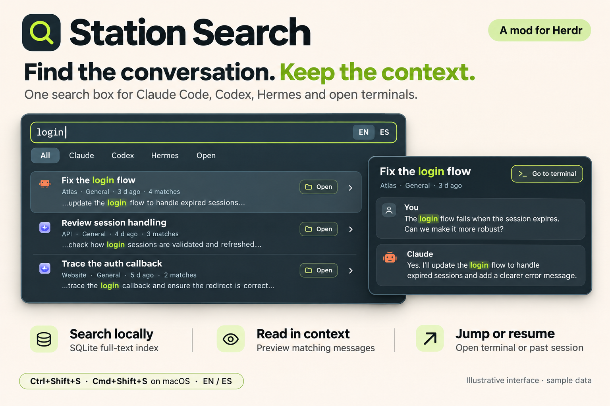
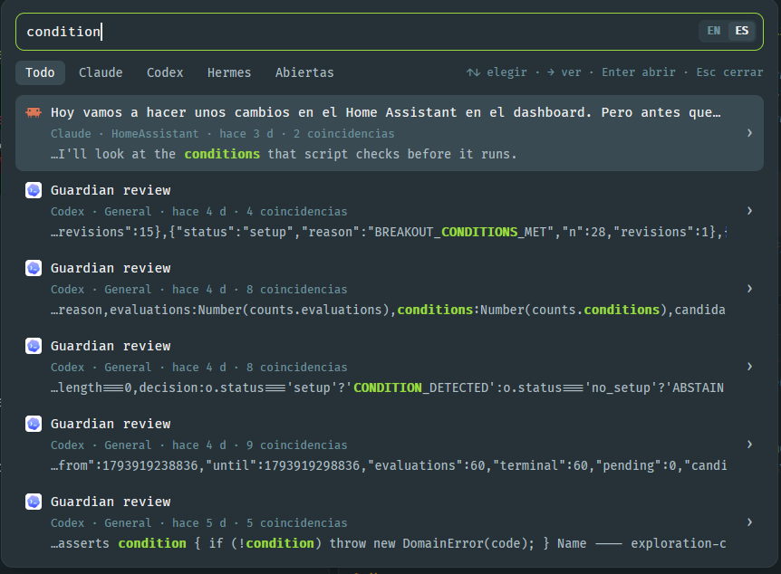

<h1 align="center">Station Search</h1>

<p align="center"><b>Find the conversation. Keep the context.</b><br>
One search box for all agents and open terminals.<br>
A native mod for the <a href="https://herdr.dev">Herdr desktop app</a>.</p>

<p align="center">
<a href="#install">Install</a> ·
<a href="#search-your-work">Features</a> ·
<a href="#keyboard--filters">Keyboard & filters</a> ·
<a href="RECIPE.md">Build recipe</a> ·
<a href="https://github.com/Verlaire/station-search/issues">Issues</a>
</p>



<p align="center"><sub>Illustrative overview with sample data. <a href="preview.png">See the actual mod screenshot.</a></sub></p>

## Search your work

You remember the fix, a phrase or the project, but not which agent you discussed it with. Open Station Search, type a few words and find the matching conversation. Read the surrounding messages before jumping back to the terminal or resuming a past session.

| Feature | What you get |
| --- | --- |
| **One search box** | Detect any agent exposed by Herdr and search its available live terminal text. Built-in history readers support Claude Code, Codex, Hermes Agent, Antigravity CLI and Pi; additional histories can be connected through normalized exports. |
| **Local full-text index** | SQLite FTS5 with case-insensitive, accent-insensitive prefix matching. Multiple words must match; `como` can find `cómo`. |
| **Highlighted results** | Conversation titles, agent, project folder, relative time, matching snippets and available match counts. Recognized running sessions show an open badge and appear first. |
| **Context before switching** | Preview the matching indexed record and up to two neighboring records, rendered as selectable Markdown. Antigravity exposes user/agent text chunks through its native index; long records are trimmed. |
| **Jump or resume** | Focus an open session's terminal, or resume a saved conversation in a new tab through its agent CLI. |
| **Agent & folder filters** | Filters discover agents from Herdr and configured history sources instead of using a closed list. Use `/antigravity`, `/pi`, any discovered `/agent-id`, `/open` or `#folder`. |
| **Keyboard navigation** | Pick results, open previews, return to the list and jump into a session. |
| **English & Spanish** | Follow the system language or choose EN / ES inside the search field. |

The mod uses Herdr's native UI and current theme. It can be installed in an existing layout; the full Station layout is not required.

## Install

You need the **Herdr desktop app**, **Python 3 with SQLite FTS5**, and `hc` available to the helper. To resume a saved conversation, its agent CLI must also be installed and usable. No extra Python packages or new API keys are required for search.

**With an agent inside Herdr**, paste:

```text
Install Station Search from https://github.com/Verlaire/station-search.
Read my installed ~/.config/herdr-app/AGENTS.md, then the repository's
README.md, RECIPE.md and source files before copying anything.
This mod reads local agent histories and open terminal contents, writes
a local search index, and runs Python and hc. Resuming a result starts
the corresponding agent CLI in a new tab.
Copy mods/station-search into my Herdr app home without overwriting an
existing mod. Merge the appropriate shortcut snippet into my keys.json;
ask before replacing an existing binding. Check the mod, open it and
verify search and inline context in my installed Herdr version.
```

**Manually:**

1. Clone this repository and inspect its [recipe](RECIPE.md) and source.
2. Copy `mods/station-search/` into your Herdr app home's `mods/` directory, normally `~/.config/herdr-app/mods/`. If that name already exists, preserve it and resolve the collision before copying. A rename also needs the helper path and command references updated.
3. Merge the `global` entry from [keys.json](keys.json), or [keys.macos.json](keys.macos.json) on macOS, into your existing app `keys.json`. Preserve all other bindings; choose another shortcut if the key is taken.
4. Run `herdr-app check <app-home>/mods/station-search`, inspect `herdr-app status`, then open the mod and verify it visually.

```sh
git clone https://github.com/Verlaire/station-search.git
# After copying the mod and merging the shortcut:
herdr-app do mod.open --name station-search
```

**Ctrl+Shift+S** opens the search on Windows/Linux; **Cmd+Shift+S** on macOS. The first query builds an index of your local histories and can take longer than later searches. Subsequent queries re-read changed source files.

## Keyboard & filters

| Action | Key / control |
| --- | --- |
| Open or close search | Ctrl+Shift+S / Cmd+Shift+S, once the shortcut is merged |
| Pick a result | ↑ / ↓ |
| Open the selected terminal or resume its session | Enter or click the result |
| Read a matching conversation | `›` chevron, or → when the results list has focus |
| Return from the preview | `‹`, ← when the list has focus, or Esc |
| Scroll the conversation preview | ↑ / ↓ or mouse wheel |
| Close from the results list | Esc |
| Choose language | EN / ES inside the field |

While the search field has focus, ← and → move its caret. Press ↑ or ↓ to move keyboard focus to the results; typing returns to the field.

| Filter | Example |
| --- | --- |
| Claude Code history | `/claude login` |
| Codex history | `/codex callback` |
| Hermes Agent history | `/hermes migration` |
| Antigravity CLI history and live text | `/antigravity login` (alias `/agy`) |
| Pi history and live text | `/pi refactor` |
| Any other detected agent's live text / configured export | `/my-agent login` |
| Running sessions and live terminals | `/open build` |
| Folder name/path contains a word | `#website login` |
| Combine an agent and folder | `/claude #api auth` |

Agent filters select both the corresponding saved history and available live terminal text. `/open` combines with an agent or folder filter. Unknown agents get a generic icon and can be filtered without a code change. Live text is limited to what `hc` exposes; archived formats require a built-in reader or [configured export](docs/agents.md). Detecting every open agent does not imply access to every agent's private historical storage.

Typing an exact agent filter moves the highlighted chip to that agent, including aliases such as `/agy`. The indicator follows your input immediately, before search finishes. Combined searches for multiple agents use All; adding `/open` to one agent keeps that agent highlighted. The movement is native and can be disabled with `herdr-app do station-search.motion:off` (`motion:on` enables it again).

<details>
<summary><b>Actual screenshot</b></summary>



This is a real installation. The visible conversation titles, snippets and project names belong only to the screenshot; no histories or machine configuration are bundled.

</details>

<details>
<summary><b>Data & privacy</b></summary>

Search runs locally. It reads supported agent histories, inspects local processes to identify running sessions, and calls `hc ls`, `hc get` and `hc read` for terminal metadata and text. Its index is a local SQLite file. The search engine does not call a hosted search service or an LLM.

| Source | Default location |
| --- | --- |
| Claude Code | `~/.claude/projects/*/*.jsonl` |
| Codex | `$CODEX_HOME/sessions/**/rollout-*.jsonl`, defaulting to `~/.codex` |
| Codex conversation titles | `session_index.jsonl` in the Codex home |
| Hermes Agent | `$HERMES_HOME/state.db`, defaulting to `~/.hermes` (opened read-only) |
| Antigravity CLI | `$ANTIGRAVITY_HOME/conversation_summaries.db`, defaulting to `~/.gemini/antigravity-cli` (native full-text chunks, read-only) |
| Pi | `$PI_CODING_AGENT_DIR/sessions/*/*.jsonl`, defaulting to `~/.pi/agent` |
| Additional agents | Normalized JSON/JSONL export paths configured in `~/.config/station-search/sources.json` (`STATION_SEARCH_SOURCES` overrides the config path) |
| Search index | `~/.cache/station-search/index.db`, overridable with `STATION_SEARCH_DB` |

The index contains searchable conversation text and should be treated as private. Source conversations are not edited. Tool calls, tool output and messages recognized as system injections are excluded from the history index; live terminal text can include whatever is visible in terminal output.

Jumping to a result changes terminal focus. Resuming a result starts its supported agent CLI (`claude --resume`, `codex resume`, `hermes --resume`, `agy --conversation`, or `pi --session`); those agents use their own normal configuration and services. A configured export has no resume command unless you explicitly supply one; otherwise it opens as read-only context.

</details>

<details>
<summary><b>Questions & troubleshooting</b></summary>

**Do I need the Station layout?** No. This repository contains the standalone Station Search mod and shortcut snippets.

**Does it search every agent?** Any agent exposed by Herdr can be detected and searched through its available live terminal text, including agents added later. Saved-history readers are included for Claude Code, Codex, Hermes Agent, Antigravity CLI and Pi. Use [normalized exports](docs/agents.md) for other historical formats; there is no universal on-disk format shared by all agents.

**Why is an Antigravity conversation missing?** Antigravity CLI must have populated its own `conversations_fts` index. Station Search reads that index's user/agent chunks; it does not decode private protobuf trajectory files or force Antigravity to index them. The desktop IDE's storage is a different format. An open Antigravity terminal remains searchable even if native history indexing is unavailable.

**Why is a running Hermes conversation not marked open?** Hermes can use a shared gateway. The helper needs optional `$HERMES_HOME/agent-hooks/state/<session>.terminal` mappings to associate a session with its terminal. Without them, its saved conversations remain searchable and resumable. See [RECIPE.md](RECIPE.md#watch-out).

**Why didn't it jump to the exact matching line?** Herdr focuses the terminal; it does not seek to a historical match inside a full-screen agent. Use the inline preview to read the match in context.

**Python is installed, but the mod cannot find it.** Verify that `python3` or `python` resolves to Python 3 in the environment used by Herdr. The bundled helper requires SQLite with FTS5 enabled.

**The first query is slow.** It indexes the supported histories first. Time and index size depend on your data; later searches only re-read changed files (including SQLite WAL updates). Results are bounded: up to 3,000 matching indexed records are considered and up to 60 conversation groups are returned after folder/open filtering. A source that cannot be read is skipped independently and retains its last good indexed data.

**Search is stuck or errors after an update.** Use the latest source, run the native mod check and inspect `herdr-app status`. The current view cancels superseded search tasks and cancels its tasks when closed. Report your Herdr version and relevant errors, without including private conversation content.

The first import can take longer than Herdr's default helper timeout. Queries allow up to ten minutes for indexing; an execution or decoding failure is displayed as a search error instead of “No results”.

**How do I update or remove it?** Review and copy the new mod files, preserving any local modifications. To remove it, close the overlay, remove its shortcut binding and installed mod folder. Its cache is separate; delete the local index only if you intend to discard indexed data.

</details>

## Build & contribute

[RECIPE.md](RECIPE.md) documents the design, native components, search semantics, integration limits and acceptance checks. The Python helper uses only the standard library; the UI uses Herdr's native GPUI API. Read your installed Herdr guide and type declarations before adapting the mod.

For Herdr gallery sharing, the repository includes `mods/station-search/`, `RECIPE.md`, a real `preview.png`, keyboard snippets and the `herdr-mod` topic. The promotional illustration is separate from the gallery screenshot. Gallery discovery is operated by Herdr; changing this README does not control its index or browser rendering.

[MIT](LICENSE) © 2026 Verlaire
