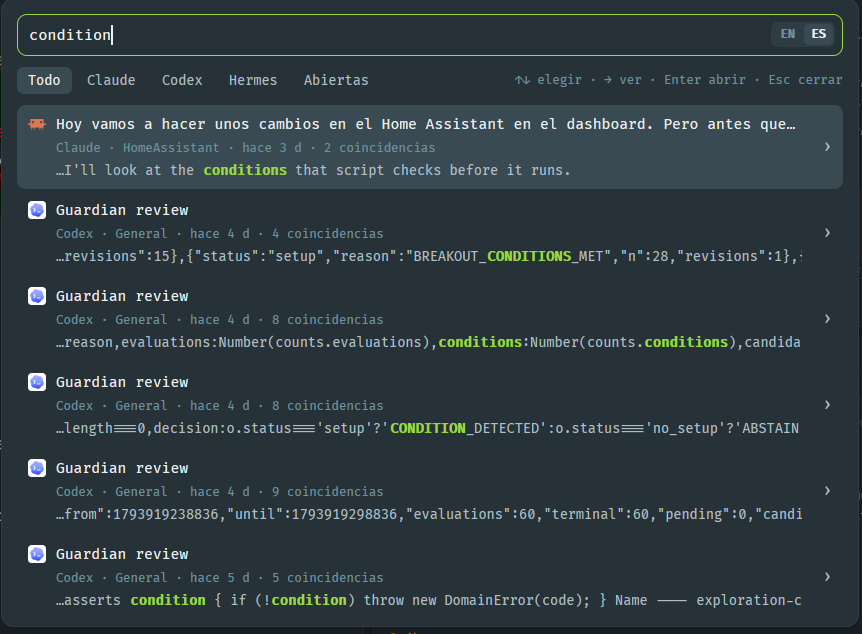

# Station Search

A [Herdr](https://herdr.dev) mod: one search box over every coding agent's conversations
(Claude Code, Codex and Hermes Agent), past and present, plus the open terminals.

## Shortcut

**Ctrl+Shift+S** (**Cmd+Shift+S** on macOS) opens the search.

- Type to search; accents and case don't matter.
- **Enter** or click: go to the session's terminal if it's open, or resume it in a new tab.
- **→** or the `›` chevron: read the conversation inline; **←** or **Esc** goes back.
- **↑↓**: move through results, or scroll the conversation.
- Filters: `/claude`, `/codex`, `/hermes`, `/open`, `#folder`.
- EN · ES switch inside the search field.

## Install

Copy `mods/station-search` into `~/.config/herdr-app/mods/` and merge `keys.json`
(`keys.macos.json` on macOS) into `~/.config/herdr-app/keys.json`. Requires Python 3.

See [RECIPE.md](RECIPE.md) for the full design and behavior.

## License

MIT © Verlaire
