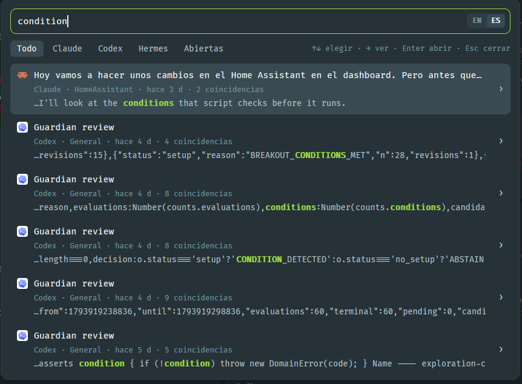

# Station Search

One search box over every coding agent's conversations: Claude Code, Codex and Hermes Agent,
past and present, plus what's on the screen of every open terminal. Type a few words and the
sessions that talked about them come up, newest first, with the matching words highlighted.
Pick one to jump to its terminal if it's running, or resume it in a new tab if it isn't; open
it inline to read the match in context first.

## What you see

A card 780px wide on `popover` (12px radius, 1px `border`, `shadow_lg`, 14px padding), as tall as
its content: the results list grows up to 460px and then scrolls; the conversation is 460px.
The overlay itself is a fixed 800 × 600 dialog with `frame: "none"`, and the card sits at its
top, so the field stays put while results come and go (a hugging dialog is re-centered on every
change, and the field jumps).

- **Search field**, 38px, 9px radius, 1px `accent` border on `background`. The border and
  background belong to a row holding a borderless `Input` (`border_0`) and, inside on the right,
  an EN · ES switch (10.5px semibold on `raised`, the current language on `selected`):
  `Input` has no suffix slot, so the row draws the field.
- **Filter row**: text chips All · Claude · Codex · Hermes · Open (12px; the picked one on
  `selected`), then the keys hint flush right in 11px `dim`.
- **Results**: rows 7px tall padding, 8px radius, the picked one on `selected`, hover `hover`.
  Each row: the agent's 16px icon (Herdr's `icons/<agent>.svg`; Hermes' is one color, drawn in
  `foreground`), the title (13px, medium, truncated), an "open" badge (10.5px `accent` on
  `raised`) when the session is running in a terminal, a meta line in 11px `dim`
  (agent · folder · how long ago · N matches) and the snippet in 12px `muted` with the matched
  words in `accent`, semibold. A 28px `›` chevron on the right.
- **Conversation** (replaces the results): a header with a 28px `‹` back button, the icon, the
  title and a primary button (`solid` / `solid_foreground`): "Go to terminal" or "Resume
  session". Below, the matched message and two messages either side as cards (10px padding,
  8px radius, 1px `border`); the match's card is on `raised` with an `accent` border and its
  words marked with `<mark>` in `accent` blended 45 % into `popover`. Each card says who wrote
  it ("You" or the agent) and when, then the message as Markdown, selectable.

Empty states: a hint before typing, Herdr's `mods/workspace-chrome/spinner.svg` turning in
`accent` (22px, `.spin(900)`, 28px above and below) while searching, "No results." and,
without Python 3, what's missing.

## How it behaves

- Typing searches after 250 ms. Words are ANDed and prefix-matched; accents and case don't
  matter ("como" finds "cómo"). `/claude`, `/codex`, `/hermes` keep one agent, `/open` keeps
  what's running now, `#word` keeps sessions whose folder contains it.
- **Click a result or Enter**: a running session focuses its terminal (`agent.focus`); a past one
  resumes in a new tab in its folder (`tab.new {folder, argv}`): `claude --resume <id>`,
  `codex resume <id>`, `hermes --resume <id>`.
- **Chevron or →** opens the conversation; **‹, ← or Esc** goes back. **↑↓** pick a result, or
  scroll the conversation 60px at a time (the wheel too).
- **Keyboard focus**: while the field has it, ← → move the caret. ↑↓ hand the keyboard to the
  list (a focus handle on the root); typing or Backspace there hands it back to the field with
  the character added.
- **Esc** closes the dialog from the results.
- **Language**: English or Spanish. Until someone picks one, the system's UI language
  (`search.py lang`). The EN · ES switch (or `herdr-app do station-search.lang:es`, empty to
  follow the system again) keeps the choice in shared `station-search.lang`. Adding a language
  is one more entry in `TEXT`; the switch lists them all.

## Built from

- `mods/station-search/mod.json`: `place: none`, focusable, a dialog overlay 800 × 600 with
  `frame: "none"`; the mod draws the card. Mark the field and filter rows `flex_none`, or a
  short card squeezes the field.
- `mods/station-search/main.js`: the view. It finds Python (`python3`, then `python`, checking
  it is 3) and runs `search.py` with `exec`. Herdr functions: `exec`, `run` (`agent.focus`,
  `tab.new`), `closeOverlay`, `props`, `theme`, `shared` / `setShared`, `appHome`,
  `nextCommand`. gpui-base: `InputState` / `Input`, `TextView.markdown`.
- `mods/station-search/search.py` (Python 3, standard library only):
  - **Index**: SQLite FTS5 at `~/.cache/station-search/index.db` (`STATION_SEARCH_DB` overrides),
    tokenizer `unicode61 remove_diacritics 2`. One row per user or assistant text message
    (tool calls, tool output and messages starting with `<`, which are system injections, are
    left out). Updated before every query, re-reading only files whose mtime or size changed.
    About 15 KB of index per MB of transcripts.
  - **Claude Code**: `~/.claude/projects/*/*.jsonl`, `type` user / assistant, not `isMeta` or
    `isSidechain`; the session's folder is the first `cwd` (resume needs the folder it started in).
  - **Codex**: `$CODEX_HOME/sessions/**/rollout-*.jsonl` (`~/.codex` by default):
    `session_meta` gives id and folder, `response_item` messages the text. Titles come from
    `session_index.jsonl` (`thread_name`).
  - **Hermes Agent**: `$HERMES_HOME/state.db` (`~/.hermes` by default), tables `sessions` and
    `messages`, read-only.
  - **Live terminals**: `hc ls --json`, `hc get`, `hc read` (screen and scrollback).
  - **Which terminal runs a session**: Claude Code from `~/.claude/sessions/<pid>.json`, walking
    up the process tree (Windows Toolhelp, Linux `/proc`, macOS `ps`) to a terminal's pid; Codex
    by its terminal title's first part matching the thread name; Hermes from optional
    `$HERMES_HOME/agent-hooks/state/<session>.terminal` files (see Watch out).
  - Commands: `index`, `query <text>`, `context <row> <text>` (the match marked with `\x01` /
    `\x02`, two messages either side, long ones trimmed around the match), `lang`.
- `keys.json`: `ctrl-shift-s` → `mod.open:station-search` (`keys.macos.json`: `cmd-shift-s`).
- **Dev hooks** (`herdr-app do station-search.<x>`): `query:<text>`, `select:<n>`, `detail`,
  `scroll:<px>`, `lang:<code>`.

## Watch out

- An input's `change` handler gets a `cx` that can't `spawn`: only store the text and `notify`;
  `render` notices the new query and spawns the search (keyed, so it runs once).
- `snippet()` can't be used with `GROUP BY` in FTS5: fetch matching rows newest first and group
  in Python.
- Only virtual lists scroll from code, and messages have different heights: the conversation
  scrolls by hand (an `overflow_hidden` box, a negative top margin, sizes from `on_size_change`).
- `terminal.search` takes no arguments and doesn't open from a mod, and full-screen agents keep
  old messages out of the terminal's scrollback, so jumping to a match inside a terminal can't
  be done: the inline conversation is the answer.
- Windows' default console encoding isn't UTF-8: `search.py` reconfigures stdout.
- Create `mod.json` before `main.js`: a mod folder seen without it is placed into the layout.
- Hermes runs its agent in a shared gateway, so nothing in the CLI's terminal says which session
  it shows. A Hermes hook plus a watcher in the CLI's terminal can write
  `$HERMES_HOME/agent-hooks/state/<session>.terminal` holding `$HC_TERMINAL_ID`; without it,
  Hermes sessions are still found and resumed, just never marked open.
- The first query builds the index (about a minute for a few GB of transcripts); later ones take
  0.3–1.5 s.

## Done when

- `python search.py index` builds the index and `query hola` prints JSON.
- Ctrl+Shift+S opens the dialog; typing shows results with highlighted words; "como" finds
  "cómo".
- A running session shows "open" and Enter focuses its terminal; a past one opens a new tab
  that resumes it.
- → shows the conversation with the match marked; ↑↓ scroll it; ← returns.
